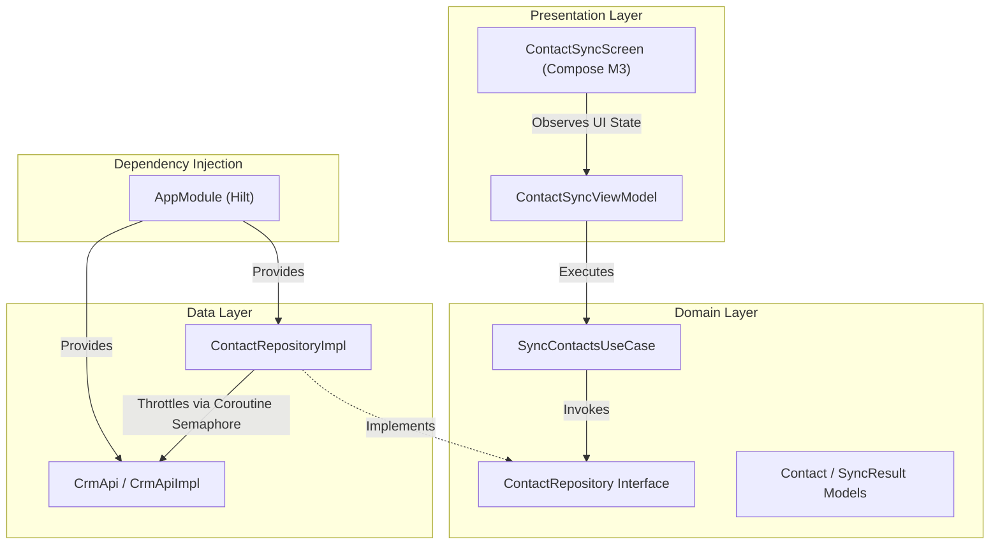

# 🚥 Semaphore — Android CRM Contact Synchronization & Rate-Limiting Engine

[](https://developer.android.com/)
[](https://kotlinlang.org/)
[](https://developer.android.com/jetpack/compose)
[](https://developer.android.com/training/dependency-injection/hilt-android)
[](https://developer.android.com/)

**Semaphore** is a modern Android application demonstrating high-performance, asynchronous batch data synchronization with dynamic SLA rate limiting using Kotlin Coroutines `Semaphore`. Designed according to Clean Architecture and MVVM design patterns, Semaphore showcases how to manage concurrent HTTP requests efficiently while respecting server rate limits and connection pooling constraints.

---

## 📑 Table of Contents
- [Overview & Use Case](#-overview--use-case)
- [Key Features](#-key-features)
- [Architecture](#-architecture)
- [Project Structure](#-project-structure)
- [Core Implementation Highlight](#-core-implementation-highlight)
- [Tech Stack](#-tech-stack)
- [Getting Started](#-getting-started)
- [Usage Guide](#-usage-guide)
- [License](#-license)

---

## 🎯 Overview & Use Case

When synchronizing large amounts of data (such as CRM contacts) between an enterprise mobile application and remote backend servers, unthrottled concurrent requests can overload backend infrastructure, trigger HTTP `429 Too Many Requests` status codes, or cause transient HTTP `503 Service Unavailable` errors.

**Semaphore** addresses this challenge by wrapping individual async coroutine executions in `kotlinx.coroutines.sync.Semaphore`. It enables real-time tuning of maximum concurrent permits (1 to 20 requests), giving developers and operators precise control over backend load and SLA compliance.

---

## ✨ Key Features

- **⚡ Dynamic Concurrency Control:** Interactively tune maximum concurrent network requests (1–20 permits) on the fly using a Compose slider.
- **🔄 Efficient Batch Processing:** Asynchronously processes hundreds of contacts concurrently using `async` / `awaitAll` combined with `Semaphore.withPermit`.
- **📊 Real-Time Telemetry & Progress:** Visual progress bar updating live progress (`completed` / `total`), total execution runtime in milliseconds, and success vs. failure counts.
- **🛡️ Resilience & Error Handling:** Built-in fault tolerance using `runCatching` to gracefully handle and report transient network failures (e.g., simulated 503 errors) without halting overall execution.
- **📱 Modern Jetpack Compose UI:** Material 3 design system with native Edge-to-Edge support, responsive layout components, and preview modes.
- **💉 Dependency Injection with Hilt:** Fully modularized components decoupled via Hilt bindings (`@SingletonComponent`, `@HiltViewModel`).

---

## 🏗️ Architecture

The project adheres strictly to **Clean Architecture** principles and the **MVVM (Model-View-ViewModel)** design pattern, keeping presentation logic separated from domain business rules and data source access.



### Layer Responsibilities

1. **Domain Layer:** Defines core business models (`Contact`, `SyncResult`), repository contracts (`ContactRepository`), and use cases (`SyncContactsUseCase`). Completely free of framework dependencies.
2. **Data Layer:** Implements data sources (`CrmApiImpl` simulating network latencies and transient errors) and repositories (`ContactRepositoryImpl`) managing coroutine concurrency logic.
3. **Presentation Layer:** Renders UI components using Jetpack Compose (`ContactSyncScreen`) driven by reactive state flows (`ContactSyncViewModel`).
4. **DI Layer:** Configures Hilt bindings for singletons and view models.

---

## 📁 Project Structure

```text
com.example.semaphore/
├── SemaphoreApp.kt                       # Application class annotated with @HiltAndroidApp
├── data/
│   ├── remote/
│   │   ├── CrmApi.kt                     # API interface for contact operations
│   │   └── CrmApiImpl.kt                 # Mock API implementation with latency & error simulation
│   └── repository/
│       └── ContactRepositoryImpl.kt      # Repository implementing Semaphore concurrency control
├── di/
│   └── AppModule.kt                      # Hilt module for API & repository bindings
├── domain/
│   ├── model/
│   │   └── Contact.kt                    # Data classes (Contact, ContactResponse, SyncResult)
│   ├── repository/
│   │   └── ContactRepository.kt          # Domain repository interface definition
│   └── usecase/
│       └── SyncContactsUseCase.kt        # Use case encapsulating sync invocation
└── presentation/
    ├── MainActivity.kt                   # Main activity entry point with edge-to-edge support
    ├── sync/
    │   ├── ContactSyncScreen.kt          # Compose screen UI
    │   └── ContactSyncViewModel.kt       # ViewModel exposing StateFlow UI state
    └── ui/theme/                         # Material 3 Color, Type, and Theme definitions
```

---

## 💡 Core Implementation Highlight

The core concurrency regulation occurs in `ContactRepositoryImpl.kt` using `kotlinx.coroutines.sync.Semaphore`:

```kotlin
override suspend fun syncContacts(
    contacts: List<Contact>,
    maxConcurrency: Int,
    onProgress: suspend (completed: Int, total: Int) -> Unit
): SyncResult = coroutineScope {

    // Instantiate Semaphore with the user-defined max concurrency permits
    val semaphore = Semaphore(permits = maxConcurrency.coerceAtLeast(1))
    val completedCount = AtomicInteger(0)
    val total = contacts.size

    val results = contacts.map { contact ->
        async {
            val result = runCatching {
                // Acquire permit before dispatching network request
                semaphore.withPermit {
                    api.upsertContact(contact)
                }
            }
            val currentCompleted = completedCount.incrementAndGet()
            onProgress(currentCompleted, total)
            result
        }
    }.awaitAll()

    SyncResult(
        successful = results.mapNotNull { it.getOrNull() },
        failed = results.mapIndexedNotNull { index, result ->
            result.exceptionOrNull()?.let { contacts[index] to it }
        },
        totalProcessed = total
    )
}
```

---

## 🛠️ Tech Stack & Dependencies

| Category | Tool / Library | Version / Details |
| :--- | :--- | :--- |
| **Language** | [Kotlin](https://kotlinlang.org/) | `2.2.10` |
| **Build System** | Gradle (Kotlin DSL) | AGP `9.4.0-alpha07` / Gradle Version Catalog |
| **Target / Min SDK** | Android SDK | Target `37` / Min `24` |
| **UI Toolkit** | [Jetpack Compose](https://developer.android.com/jetpack/compose) | Material 3 (BOM `2026.09.00`) |
| **Dependency Injection** | [Hilt](https://dagger.dev/hilt/) | `2.60.1` (with KSP compiler) |
| **Concurrency** | Kotlin Coroutines | `kotlinx.coroutines.sync.Semaphore`, `Flow`, `StateFlow` |
| **Architecture** | MVVM + Clean Architecture | AndroidX Lifecycle `2.11.0` |

---

## 🚀 Getting Started

### Prerequisites

- **Android Studio:** Ladybug (2024.2+) or newer.
- **JDK:** Version 17 or higher.
- **Android SDK:** Installed API 37 target SDK.

### Building & Running

1. **Clone the Repository:**
   ```bash
   git clone https://github.com/your-username/semaphore.git
   cd semaphore
   ```

2. **Build the Debug APK via Gradle:**
   ```bash
   ./gradlew assembleDebug
   ```

3. **Run Unit Tests:**
   ```bash
   ./gradlew test
   ```

4. **Install on Connected Device / Emulator:**
   ```bash
   ./gradlew installDebug
   ```

---

## 📖 Usage Guide

1. Launch the **Semaphore** app on an Android device or emulator.
2. Use the **Server SLA Concurrency Limit** slider to set your desired maximum concurrency level (e.g., `4` concurrent permits).
3. Tap **Start Sync (200 Contacts)**.
4. Observe the live linear progress indicator updating as coroutines execute network calls within the configured permit limit.
5. Review the execution summary upon completion, including total elapsed time in milliseconds and failure counts.

---

## 📄 License

```text
Copyright 2026 Semaphore Project

Licensed under the Apache License, Version 2.0 (the "License");
you may not use this file except in compliance with the License.
You may obtain a copy of the License at

    http://www.apache.org/licenses/LICENSE-2.0

Unless required by applicable law or agreed to in writing, software
distributed under the License is distributed on an "AS IS" BASIS,
WITHOUT WARRANTIES OR CONDITIONS OF ANY KIND, either express or implied.
See the License for the specific language governing permissions and
limitations indoors under the License.
```
